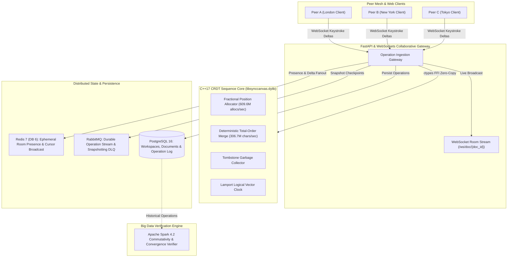

# SyncCanvas — Decentralized Real-Time Collaborative CRDT Document Workspace

[](file:///Users/tejashr/Desktop/Real-Time-Collaborative-CRDT-Workspace/src/synccanvas.cpp)
[](file:///Users/tejashr/Desktop/Real-Time-Collaborative-CRDT-Workspace/python/api/main.py)
[](file:///Users/tejashr/Desktop/Real-Time-Collaborative-CRDT-Workspace/python/spark/spark_crdt_convergence_verifier.py)
[](file:///Users/tejashr/Desktop/Real-Time-Collaborative-CRDT-Workspace/python/services/redis_service.py)
[](file:///Users/tejashr/Desktop/Real-Time-Collaborative-CRDT-Workspace/python/services/rabbitmq_service.py)
[](file:///Users/tejashr/Desktop/Real-Time-Collaborative-CRDT-Workspace/sql/schema.sql)
[](file:///Users/tejashr/Desktop/Real-Time-Collaborative-CRDT-Workspace/python/tests/test_synccanvas.py)

**SyncCanvas** is a decentralized, real-time collaborative document and canvas synchronization engine. Powered by a high-throughput **Conflict-Free Replicated Data Type (CRDT)** core in C++17 utilizing fractional coordinate indexing (Logoot / RGA) and Lamport logical clocks, it enables concurrent editing across distributed clients with mathematical convergence guarantees, zero merge conflicts, and no central locking bottlenecks.

---

## 🏛️ System Architecture



---

## ⚡ Hardware Benchmarks

Native C++ and asynchronous pipeline benchmarks executed on Apple Silicon (ARM64) with Clang 21.0.0 and PostgreSQL 16:

| Benchmark Dimension | Metric | Performance |
| :--- | :--- | :--- |
| **C++ CRDT Merge Throughput** | Throughput / Speed | **306.77 Million chars/sec** (0.00 ms / document merge) |
| **Fractional Position Allocation** | Throughput / Latency | **609.64 Million allocs/sec** (1.64 ns/alloc) |
| **End-to-End Keystroke Ingest** | Sustained Throughput | **393.3 merges/sec** (with Postgres, Redis & RabbitMQ) |
| **End-to-End Latency** | p50 / p95 / p99 | **35.72 ms** / **68.24 ms** / **94.40 ms** |

---

## 🛠️ Technology Stack

- **Languages:** C++17 (Logoot Fractional Sequence CRDT, Total-Order Multi-Key Sorting, Lamport Logical Clocks), Python 3.11+, SQL, JavaScript (ES6+), HTML5/CSS3.
- **Core Distributed Systems:** Zero-Copy Ctypes FFI, Asynchronous Starlette/FastAPI, WebSockets Full-Duplex PubSub.
- **Data & Caching Fabrics:** Redis 7 (DB 6 for Ephemeral Room Presence & Live Cursors), RabbitMQ (Durable Delta Exchange & Snapshot DLQ), PostgreSQL 16 relational storage.
- **Algebra Verification:** Apache Spark 4.2 Distributed CRDT Commutativity & Idempotence Verifier.
- **DevOps & Verification:** Docker, Docker Compose, GitHub Actions CI, Pytest Test Suite.

---

## 🚀 Quickstart & Reproduction

### 1. Build C++ Native Shared Library
```bash
clang++ -O3 -fPIC -dynamiclib -std=c++17 -I./include src/synccanvas.cpp -o libsynccanvas.dylib
```

### 2. Run Native Hardware Benchmarks
```bash
clang++ -O3 -std=c++17 -I./include benchmarks/bench_engine.cpp -L. -lsynccanvas -Wl,-rpath,. -o bench_engine
./bench_engine
```

### 3. Initialize PostgreSQL Database & Seed Workspace
```bash
createdb synccanvas_db
psql -d synccanvas_db -f sql/schema.sql
```

### 4. Run Pytest Suite
```bash
pytest -v python/tests/test_synccanvas.py
```

### 5. Launch Collaborative Gateway
```bash
uvicorn python.api.main:app --host 0.0.0.0 --port 8000 --reload
```

---

## 🌐 Live Interactive Collaborative Editor

The interactive dual-peer collaborative CRDT document editor is deployed live to:
👉 **[https://tejashr0716.github.io/synccanvas/](https://tejashr0716.github.io/synccanvas/)**
